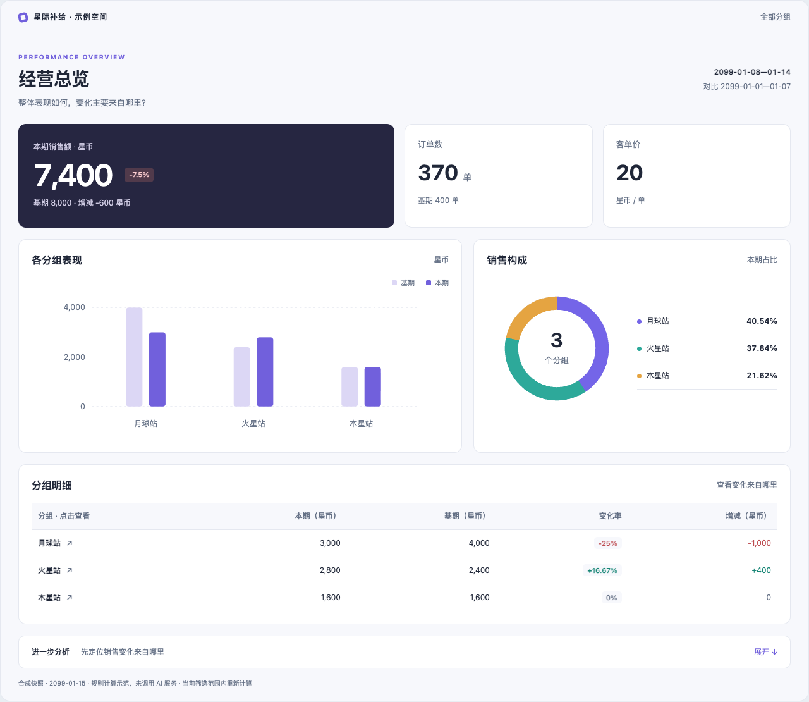
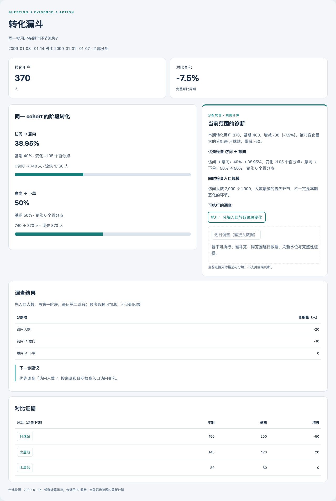
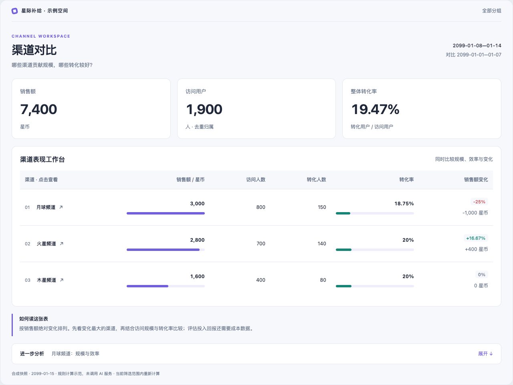
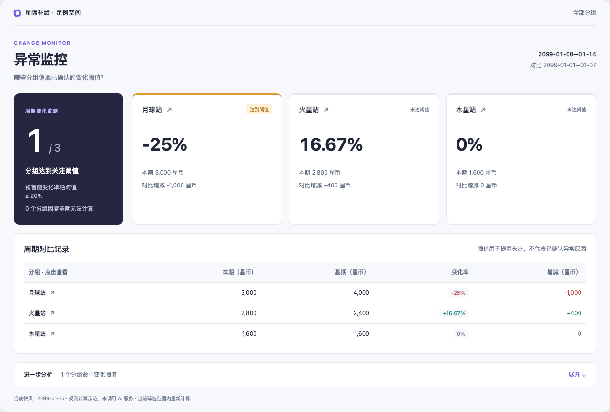

<div align="center">

# 🪐 Guanyuan BI Toolkit

**让看板好看，让数字有出处，让调查有下一步。**

在 Codex 或 Claude Code 中描述问题，让 AI 帮你设计、分析并交付观远 BI 看板。

`4 类模板` · `3 种主题` · `可执行调查` · `指标血缘` · `MIT`

[效果预览](#templates) · [安装与调用](#install) · [用自己的需求开始](#usage) · [更新指南](docs/updating.md)

</div>

## 适合谁？

- **已经会用 AI 的分析师、BI 开发者**：希望把自然语言需求、页面原型或字段说明变成可维护的看板。
- **在观远内交付报表的团队**：用 AI 辅助开发，同时沿用组织的数据源、数据集与看板权限管理。
- **接手已有看板的维护者**：需要弄清指标怎么算、筛选器影响哪里、变化值得从何处调查。

可以先用字段说明和模拟数据设计页面，再接入观远。真实数据的 AI 使用范围以组织授权为准；Skill 本身不替代平台权限管理。

<a id="templates"></a>

## 四种模板，四种调查方式

选择业务问题，再选简洁商务、紧凑分析或深色展示主题。下图展示商务主题及**点击调查后的完整结果**，点击图片可查看大图。

| 经营总览 | 转化漏斗 |
| --- | --- |
| [](docs/assets/templates/overview.png) | [](docs/assets/templates/funnel.png) |
| 看清整体变化、分组贡献，执行订单量与客单价拆解。 | 对比各阶段转化率，执行入口人数和阶段变化分解。 |

| 渠道对比 | 异常监控 |
| --- | --- |
| [](docs/assets/templates/channels.png) | [](docs/assets/templates/monitor.png) |
| 区分规模与效率，逐渠道计算流量和转化率的影响。 | 按确认的阈值发现偏离，按金额影响安排调查顺序。 |

### 点击调查，会得到什么？

以下来自截图中的合成案例，展示实际计算结果，而非预先写好的业务结论。

| 用户的问题 | 执行结果 | 下一步方向 |
| --- | --- | --- |
| 销售额为什么少了 600 星币？ | 订单量影响 **−600 星币**，客单价影响 **0** | 优先查看订单减少的分组与日期 |
| 转化用户为什么少了 30 人？ | 入口规模 **−20 人**，访问→意向 **−10 人**，意向→下单 **0** | 优先检查入口来源和第一阶段 |
| 月球频道的减少来自哪里？ | 流量影响 **−40 人**，转化率影响 **−10 人** | 检查流量来源与转化路径；预算判断还需要成本证据 |
| 哪个异常值得先查？ | 月球站 **−25%**，超阈值 **5 个百分点**，金额 **−1,000 星币** | 先核对数据刷新与口径，再查看持续时间 |

调查结果在全宽区域展示，标明单位，并随筛选范围重新计算。尚未接入逐日数据时，按钮会提前显示所需证据。分解结果说明变化构成，不直接证明业务原因。

下载仓库后打开 [模板画廊](examples/template-gallery/index.html)，可切换模板、主题和分组，体验调查、空数据与缺失字段状态。GitHub 中该链接显示源码，请在本地浏览器打开 HTML。

<a id="install"></a>

## 在 Codex / Claude Code 中安装与调用

推荐安装完整四套 Skill，然后使用统一入口 **`guanyuan-bi`**。它按任务调用页面开发、CLI 和血缘技能，你无需在它们之间搬运上下文。这里的 Claude 指本地 **Claude Code**。

### Codex

发送下面这段安装请求：

```text
请使用 $skill-installer，从 https://github.com/hhaoyy/guanyuan-bi-toolkit
安装以下四套 Skill：
- skills/guanyuan-bi
- skills/guanyuan-html-bi-generic
- skills/guanyuan-metric-lineage
- skills/guanyuan-cli

保留每个目录内的 SKILL.md、references、scripts、assets 等全部文件。
若已有同名技能，先比较差异，保留我的本地定制。
```

安装后，在技能选择器选择 `guanyuan-bi`；在 Codex CLI / IDE 中可以直接发送：

```text
$guanyuan-bi 帮我制作门店经营看板。先推荐两种布局，
用模拟数据预览，再按我确认的字段接入观远。
```

技能未显示时重启后检查。安装及显式调用方式见 [Codex 官方说明](https://learn.chatgpt.com/docs/build-skills)。

### Claude Code

发送下面这段安装请求：

```text
请从 https://github.com/hhaoyy/guanyuan-bi-toolkit 下载：
- skills/guanyuan-bi
- skills/guanyuan-html-bi-generic
- skills/guanyuan-metric-lineage
- skills/guanyuan-cli

把四个完整目录分别安装到 ~/.claude/skills/ 下，保持各自目录名。
保留 SKILL.md、references、scripts、assets 等全部内容。
若已有同名技能，先比较差异，保留我的本地定制。
```

随后发送：

```text
/guanyuan-bi 帮我制作门店经营看板。先推荐两种布局，
用模拟数据预览，再按我确认的字段接入观远。
```

安装位置与 `/skill-name` 调用方式见 [Claude Code 官方说明](https://code.claude.com/docs/en/skills)。

<details>
<summary>手动安装、项目内安装与专门技能</summary>

下载仓库，将 `skills/` 下四个完整目录复制到对应位置，不能只复制 `SKILL.md`。

| 工具 | 当前项目 | 个人所有项目 |
| --- | --- | --- |
| Codex | `.agents/skills/` | `~/.agents/skills/` |
| Claude Code | `.claude/skills/` | `~/.claude/skills/` |

| 用途 | Codex CLI / IDE | Claude Code |
| --- | --- | --- |
| 统一入口、分析需求 | `$guanyuan-bi` | `/guanyuan-bi` |
| HTML 看板设计与数据适配 | `$guanyuan-html-bi-generic` | `/guanyuan-html-bi-generic` |
| 官方 CLI 安装检查、平台操作 | `$guanyuan-cli` | `/guanyuan-cli` |
| 指标、筛选器与来源梳理 | `$guanyuan-metric-lineage` | `/guanyuan-metric-lineage` |

</details>

<a id="usage"></a>

## 用自己的需求开始

在 Codex 或 Claude Code 中打开**你自己的项目目录**，调用 `guanyuan-bi` 后接着描述任务。可以给业务问题、字段说明或已有看板链接；不必先自己写好完整的数据契约。

### 1. 新建看板：从问题到预览

```text
使用者：区域运营负责人。
问题：本期经营如何，哪些门店贡献了主要变化？
已有材料：日期、门店、订单数、销售额的字段说明。
对比范围：本周与上周的完整周期；金额单位由我确认。

请先推荐两种布局并说明适合回答什么问题，使用模拟数据制作预览。
保留分组切换、变化分析和可执行调查。
口径不明确的部分先标出来，文件保存到当前项目目录。
```

你会得到：布局建议、需要确认的口径、页面预览，以及接入所需字段。可继续说“采用紧凑主题”“把调查结果放在趋势下面”，再调整设计。

### 2. 接入与发布：沿用同一任务

```text
按我们确认的布局和口径继续。
请使用 guanyuan-cli 检查所需官方组件，复用适合的已有登录。
目标观远实例、目录和数据源使用我提供的信息或项目配置。
创建或复用数据集，完成字段绑定和发布，回读核对数据与交互。
保留源工程和资源映射，后续继续修改同一个看板。
```

安装 Skill 不等于安装官方 CLI。发布需要对应环境的访问与操作权限；没有平台访问条件时，先交付预览和接入文件。详细步骤见 [CLI 使用指南](docs/cli.md)。

### 3. 已有看板：理解口径，再分析变化

```text
请使用 guanyuan-bi 分析这个看板：[替换为我的看板链接]。
先梳理指标公式、默认筛选和数据来源。
在获准的数据范围内比较两个完整周期，找出主要变化分组。
区分数值事实、解释假设与证据缺口；继续执行可支持的调查。
这次只分析，不修改线上看板。
```

当前配置优先通过 CLI 获取，离线或明确缺口再使用 HAR。详见 [指标血缘指南](docs/lineage.md)。

## 与官方 CLI 的关系、如何更新

本仓库的 **`guanyuan-cli` 是社区编排 Skill**，指导 AI 使用观远官方工具；官方程序是 `@guandata/guancli`、`@guandata/guanvis` 等 npm 包。本仓库不打包这些二进制，也不替代官方 CLI。**更新本仓库与更新官方 CLI 是两件事。**

Skill 按用户实际安装版本适配命令与能力。检查最新版、更新已安装 Skill、升级官方组件及回退方法见 **[更新与版本兼容指南](docs/updating.md)**。

## 按需扩展

- [超级应用、可选 AI / MCP 分析与刷新演示](examples/superapp-analysis/README.md)
- [HTML 接入与数据契约](docs/html-bi.md)
- [模板字段要求与调查接口](skills/guanyuan-html-bi-generic/references/templates.md)
- [CLI 使用与常见问题](docs/cli.md)

欢迎分享使用体验、兼容性问题和通用模板。代码与文档采用 [MIT License](LICENSE)；独立社区项目，与观远官方无隶属或背书关系。
