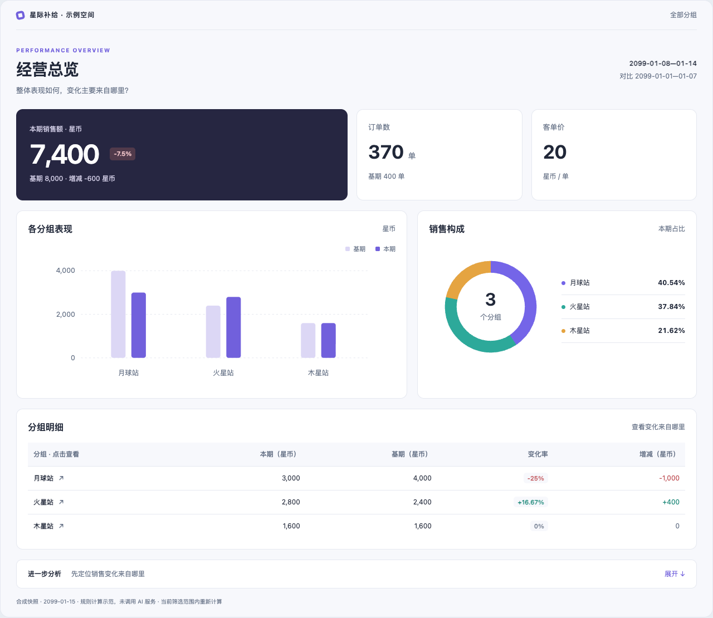
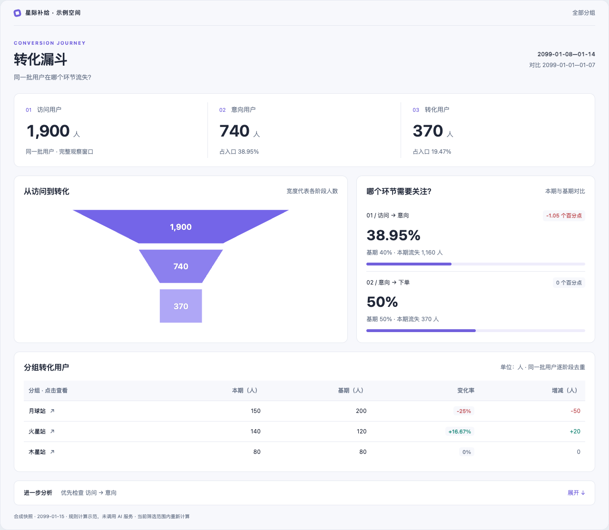
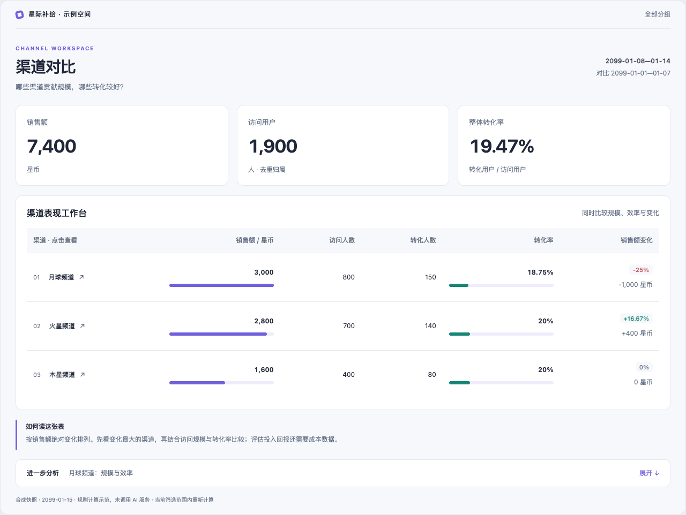
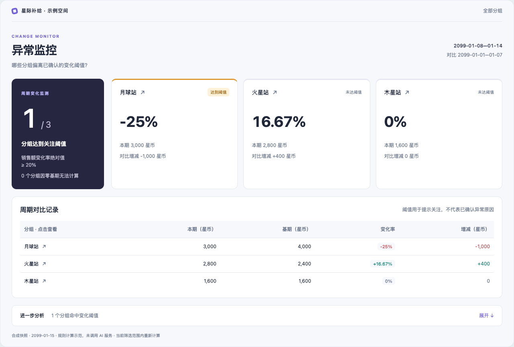

# 看板布局与交互示例

[返回首页](../README.md) · [模板字段与接口](../skills/guanyuan-html-bi-generic/references/templates.md)

四种布局对应四种阅读任务，共享指标计算与主题设置。选择时先看“要读者做什么判断”，不必为了不同业务名称重复生成相同页面。

| 阅读任务 | 页面结构 | 适用情况 |
| --- | --- | --- |
| 看整体表现 | 核心指标 + 周期柱图 + 构成环图 + 明细 | 经营周报、区域总览 |
| 找流失环节 | 阶段人数 + 漏斗 + 环节转化率 | 同一批用户的阶段转化 |
| 比较多个对象 | 汇总指标 + 带数据条的对比表 | 渠道、门店等规模与效率对比 |
| 关注偏离 | 阈值摘要 + 分组状态卡 + 对比记录 | 按事先确认的规则查看变化 |

## 经营总览

## 转化漏斗

## 渠道对比

## 异常监控

## 在本地体验

下载仓库后，用浏览器打开 `examples/template-gallery/index.html`。无需安装依赖或连接观远。

可以切换布局和主题，点击分组查看明细，再返回全部分组。顶部的数据状态选择器用于体验空数据、缺失字段和周期不完整时的提示。页面只有两个完整周期的合成汇总数据，未添加没有依据的逐日趋势。

## 需要解释变化时

看板默认展示指标与图表。展开底部的“进一步分析”，可以查看当前范围的数值发现，并继续计算：

- 经营总览：拆解订单数、客单价对销售额变化的影响。
- 转化漏斗：拆解入口人数与各阶段转化率的影响。
- 渠道对比：逐渠道拆解访问人数和转化率的影响。
- 异常监控：按金额影响排列达到阈值的分组。

例如经营总览的“拆解订单量与客单价”，会在页面下方输出带单位的完整结果和下一步建议：

这些是根据输入计算的数值分解，不是模型生成的结论，也不证明业务原因。更换分组会清除旧结果；缺少逐日数据时，相关操作会提前显示所需字段并禁用。外接模型解释与刷新能力见[超级应用说明](../examples/superapp-analysis/README.md)。

## 设计参考

本次重新设计参考以下成熟项目的信息组织方式：

- [Tabler 官方演示](https://preview.tabler.io/)：指标卡、状态标签与紧凑的管理界面层次。
- [Tremor 官方 Dashboard](https://dashboard.tremor.so/overview)：聚焦少量核心指标，组合图形与数值对比。
- [Grafana 仪表板最佳实践](https://grafana.com/docs/grafana/latest/visualizations/dashboards/build-dashboards/best-practices/)：围绕阅读目标组织页面，先概览再查看细节。

本仓库使用自行编写的 HTML、CSS 和 SVG 实现，未引入上述项目的组件代码或商业模板。发布前仍需按实际数据密度、用户设备和观远容器验证布局。
